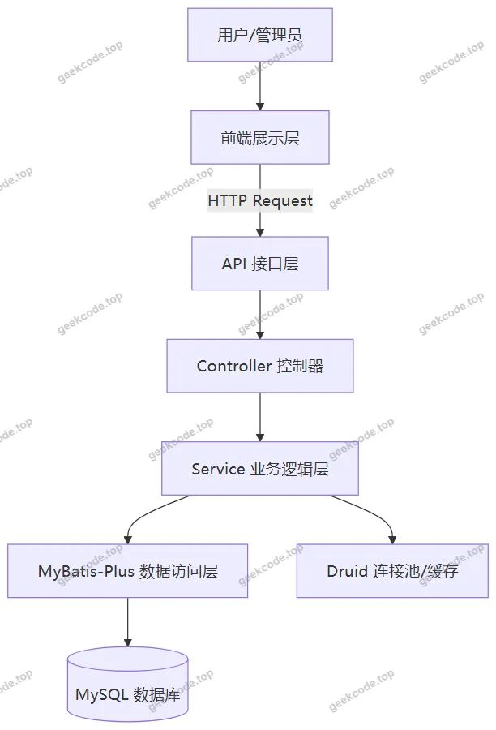
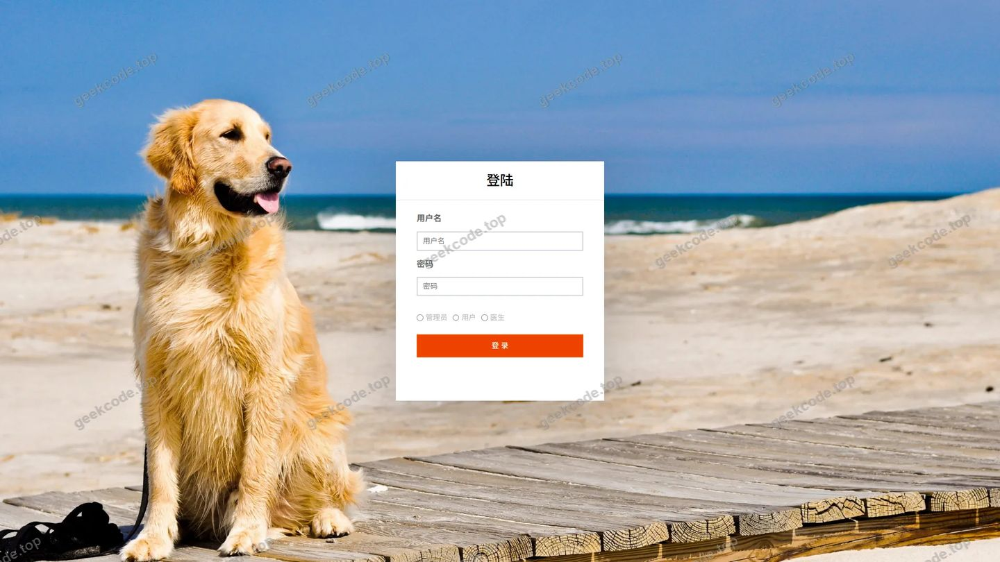
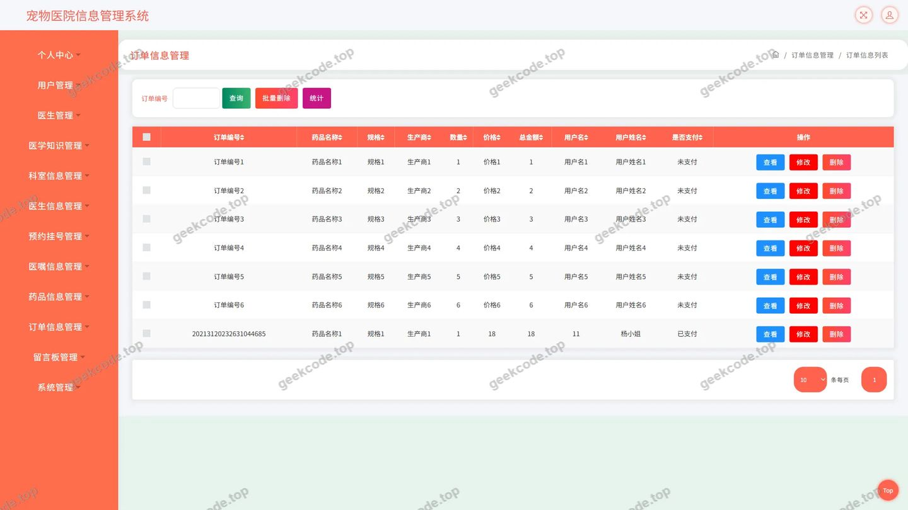
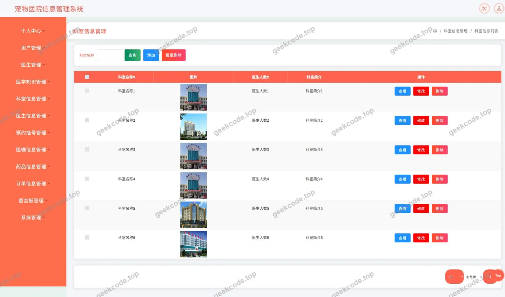
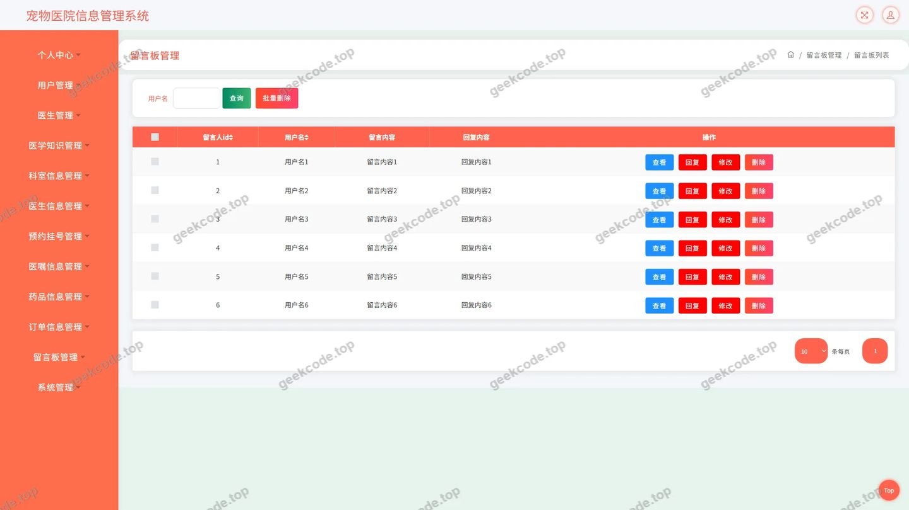
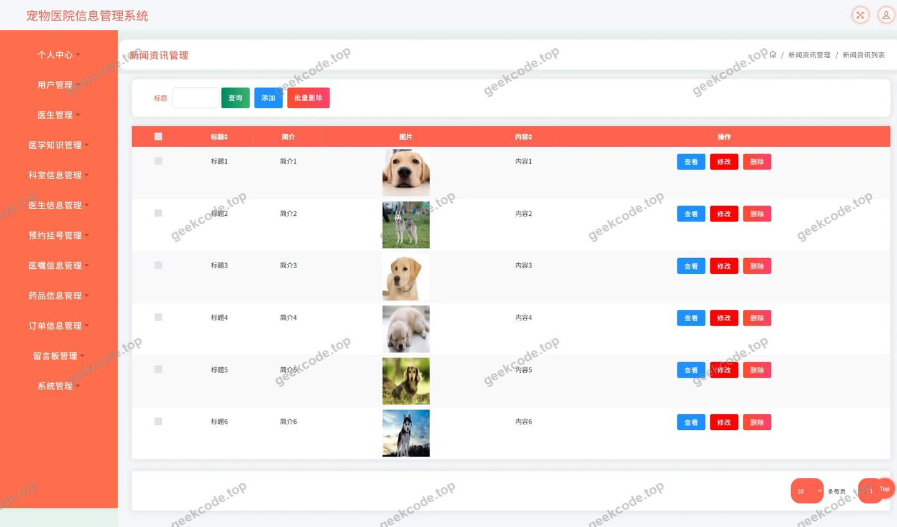
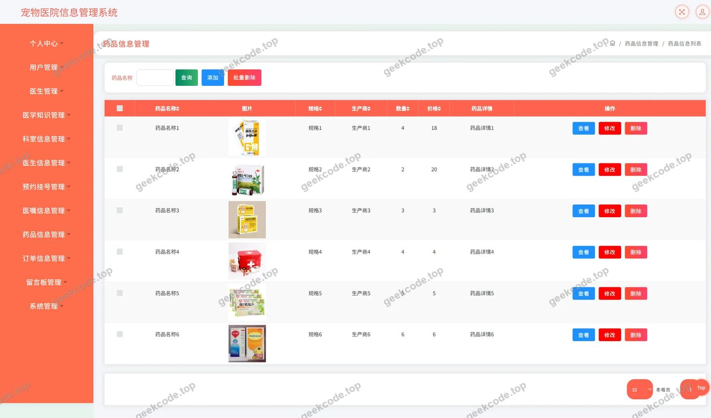
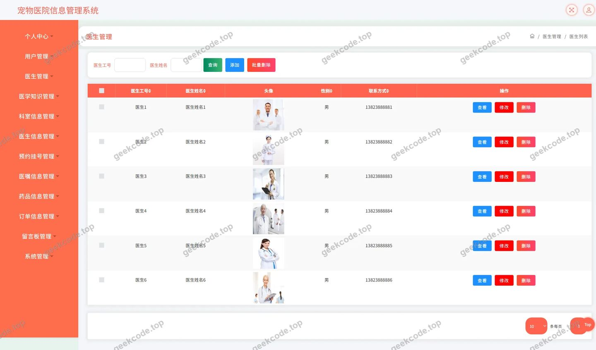
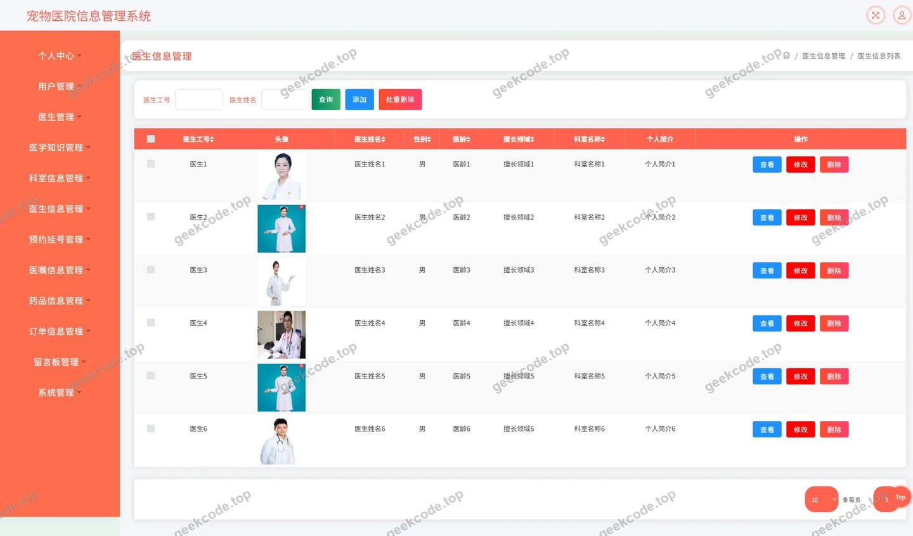
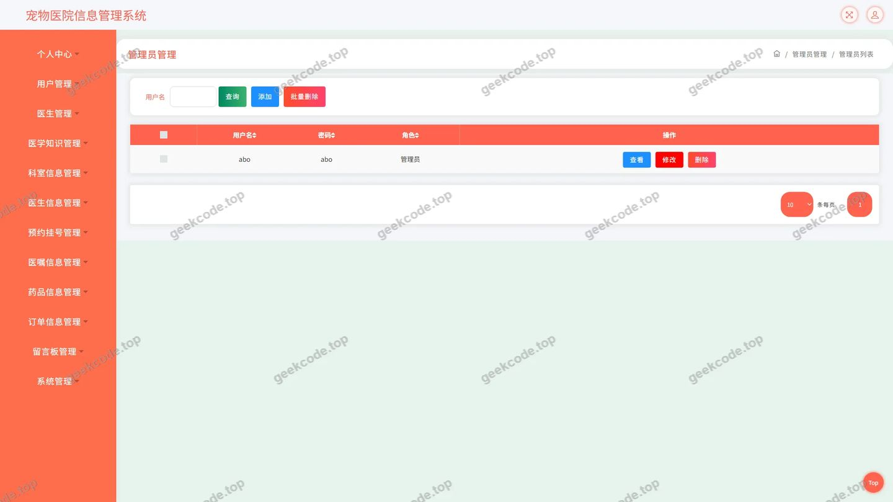

# 宠物医院信息管理系统

> 🎓 **计算机毕业设计 · 宠物医院信息管理系统**
>
> 本仓库只放**项目介绍 + 运行截图**（截图是站点带水印的原图，存在仓库 `images/` 里）。
>
> 👉 **完整可运行源码 / 数据库脚本 / 部署文档：[点我获取](https://geekcode.top/archives/%E5%AE%A0%E7%89%A9%E5%8C%BB%E9%99%A2%E4%BF%A1%E6%81%AF%E7%AE%A1%E7%90%86%E7%B3%BB%E7%BB%9F?utm_source=github)**
>
> 💬 咨询微信：**ir9372**　|　🌐 更多项目：[极客代码 geekcode.top](https://geekcode.top/?utm_source=github)
>
> 📌 项目详情页：<https://geekcode.top/archives/%E5%AE%A0%E7%89%A9%E5%8C%BB%E9%99%A2%E4%BF%A1%E6%81%AF%E7%AE%A1%E7%90%86%E7%B3%BB%E7%BB%9F?utm_source=github>

<table><td width="230" align="center"> <b>扫码加微信 ir9372</b></td><td valign="middle">📦 源码 = 项目介绍 + 全部运行截图 + 数据库 + 部署文档 👉 点上方任意截图，直接跳到 <b>极客代码 geekcode.top</b> 详情页</td></table>

---

<h1>宠物医院信息管理系统</h1>
<h2>项目概述</h2>

本项目为“宠物医院信息管理系统”，旨在通过数字化手段提升宠物医院的运营效率与服务透明度。系统核心功能涵盖医学知识科普、医生与科室信息管理、药品库存查询、新闻资讯发布以及用户留言反馈等模块，同时包含订单处理机制以支持在线服务预约或购买。适用人群主要为宠物主人（普通用户）及医院内部管理人员。技术架构采用后端分离模式，基于 Spring Boot 框架构建 RESTful API 接口，数据持久层使用 MyBatis-Plus 结合 Druid 连接池，确保高效稳定的数据交互。虽然当前形态为纯 API 服务，但其业务逻辑完整覆盖了宠物诊疗场景中的关键信息流转环节，为前端应用提供了坚实的数据支撑基础。

<h2>技术架构</h2>
<h3>1. 总体架构设计</h3>

本系统采用典型的 B/S 架构变体，具体表现为前后端分离的 API 服务模式。后端作为核心业务引擎，负责处理所有逻辑运算、数据存取及安全验证；前端（包括移动端或 Web 端界面）通过 HTTP 协议调用后端提供的 JSON 格式接口获取数据并渲染页面。

<h3>2. 核心技术选型</h3>
<ul>
<li><strong>开发框架</strong>：基于 <code>Spring Core</code>、<code>Spring Context</code>、<code>Spring Web MVC</code> 构建轻量级且高内聚的低耦合应用环境。利用 <code>Spring AOP</code> 实现日志记录与权限校验等非业务逻辑代码的解耦。</li>
<li><strong>ORM 框架</strong>：选用 <code>MyBatis-Plus</code>，在保留 MyBatis 灵活 SQL 编写能力的同时，提供通用的 CRUD 操作封装，显著减少样板代码，提升开发效率。</li>
<li><strong>数据库连接</strong>：集成 <code>Druid</code> 连接池，具备强大的监控功能和性能优化特性，能够有效防止数据库连接泄漏，保障高并发下的系统稳定性。</li>
<li><strong>事务管理</strong>：使用 <code>Spring TX</code> 进行声明式事务管理，确保订单创建、药品扣减等关键业务操作的数据一致性。</li>
</ul>
<h3>3. 数据库设计要点</h3>

根据 Controller 列表推断，数据库主要包含以下实体表结构：

<ul>
<li><strong>用户相关</strong>：<code>User</code>（用户基本信息）、<code>Messages</code>（留言反馈）。</li>
<li><strong>医疗资源</strong>：<code>Yishengxinxi</code>（医生详情）、<code>Keshixinxi</code>（科室介绍）、<code>Yaopinxinxi</code>（药品库存与价格）。</li>
<li><strong>内容资讯</strong>：<code>News</code>（新闻资讯）、<code>Yixuezhishi</code>（医学知识库）。</li>
<li><strong>业务流程</strong>：<code>Dingdanxinxi</code>（订单状态、金额、关联用户与商品）。</li>
<li><strong>系统配置</strong>：<code>Config</code>（系统参数配置）。</li>
</ul>
<h2>功能模块</h2>

由于项目类型为 <code>pure-api</code> 且无独立的前后台路由配置文件，以下功能模块依据 Controller 类名及截图所示的业务领域进行归纳。系统通过 API 接口暴露以下能力：

<h3>1. 基础信息与内容管理模块</h3>
<ul>
<li><strong>医学知识管理 (<code>YixuezhishiController</code>)</strong>：提供宠物常见疾病防治、护理常识等静态知识的增删改查接口，支持前端分类展示。</li>
<li><strong>新闻资讯管理 (<code>NewsController</code>)</strong>：维护医院动态、活动公告等新闻内容，支持富文本存储与分页查询。</li>
<li><strong>文件服务 (<code>FileController</code>)</strong>：提供图片上传、下载接口，用于加载医生头像、药品封面及新闻配图等资源。</li>
</ul>
<h3>2. 医疗资源管理模块</h3>
<ul>
<li><strong>医生信息管理 (<code>YishengController</code>, <code>YishengxinxiController</code>)</strong>：</li>
<li><code>YishengController</code>：处理医生账号登录、基本身份认证逻辑。</li>
<li><code>YishengxinxiController</code>：管理医生的详细档案，包括擅长领域、职称、排班信息等。</li>
<li><strong>科室信息管理 (<code>KeshixinxiController</code>)</strong>：定义医院下设科室（如内科、外科、美容科），维护科室简介及对应医生关联关系。</li>
<li><strong>药品信息管理 (<code>YaopinxinxiController</code>)</strong>：管理宠物专用药品目录，包含名称、规格、单价、库存数量及适用病症标签。</li>
</ul>
<h3>3. 用户交互与服务模块</h3>
<ul>
<li><strong>用户中心 (<code>UserController</code>)</strong>：处理用户注册、登录、个人信息修改及密码重置等核心账户功能。</li>
<li><strong>留言反馈 (<code>MessagesController</code>)</strong>：允许用户对医疗服务、药品质量等进行评价或咨询，管理员可回复或审核留言。</li>
<li><strong>订单管理 (<code>DingdanxinxiController</code>)</strong>：生成交易订单，记录用户购买的药品或服务明细，跟踪订单状态（待支付、已完成、已取消）。</li>
</ul>
<h3>4. 系统通用模块</h3>
<ul>
<li><strong>公共接口 (<code>CommonController</code>)</strong>：提供字典数据获取、验证码生成、系统时间戳等通用辅助接口。</li>
<li><strong>配置管理 (<code>ConfigController</code>)</strong>：读取或更新系统全局配置项，如轮播图链接、首页推荐位设置等。</li>
</ul>
<h2>用户角色与权限</h2>

根据现有源码结构，系统主要涉及两类角色：<strong>普通用户</strong>和<strong>系统管理员</strong>。由于是 API 项目，权限控制主要在接口层面体现。

<h3>1. 普通用户 (Regular User)</h3>

普通用户是系统的服务对象，拥有查看信息和发起交易的权限。

<ul>
<li><strong>可访问功能</strong>：</li>
<li><strong>浏览内容</strong>：查看医学知识、新闻资讯、医生简介、科室介绍、药品列表。</li>
<li><strong>个人中心</strong>：查看和编辑个人基本信息（昵称、手机号、地址）。</li>
<li><strong>互动反馈</strong>：提交留言反馈，查看自己的历史留言。</li>
<li><strong>订单管理</strong>：创建新订单（购买药品或预约服务），查看自己的订单列表及状态。</li>
<li><strong>限制</strong>：无法执行任何数据的删除、修改他人信息或系统配置操作。</li>
</ul>
<h3>2. 系统管理员 (Administrator)</h3>

管理员负责维持系统正常运行和内容合规性，拥有最高数据操作权限。

<ul>
<li><strong>可访问功能</strong>：</li>
<li><strong>全量数据管理</strong>：对所有模块（医学知识、新闻、医生、科室、药品、用户、订单、留言）执行完整的 CRUD（增删改查）操作。</li>
<li><strong>用户管理</strong>：查看所有注册用户信息，必要时禁用违规账号。</li>
<li><strong>订单监管</strong>：查看所有订单状态，处理退款申请或异常订单。</li>
<li><strong>内容审核</strong>：审核用户提交的留言反馈，确保内容健康合法。</li>
<li><strong>系统配置</strong>：修改全局参数配置，上传和管理系统静态资源文件。</li>
</ul>

<em>(注：根据截图中的“页面-登录”、“页面-用户”等视图判断，系统存在明确的身份区分，但未在代码中体现复杂的 RBAC 多级角色，故简化为上述两角色模型。)</em>

<h2>项目特色与创新点</h2>
<ol>
<li>
<strong>高度模块化的 API 设计</strong>：
   项目严格遵循单一职责原则，将医生、药品、订单等业务域拆分为独立的 Controller 模块。这种设计使得后端接口清晰易懂，便于前端多端（App、小程序、Web）并行开发与调试，提升了系统的可维护性和扩展性。

</li>
<li>
<strong>数据访问层的性能优化</strong>：
   引入 <code>Druid</code> 连接池替代传统的 HikariCP 或 DBCP，不仅提供了更细粒度的 SQL 监控能力，还能实时分析慢查询语句。配合 <code>MyBatis-Plus</code> 的条件构造器，有效避免了 N+1 查询问题，确保了在药品检索和订单列表加载时的高响应速度。

</li>
<li>
<strong>完善的业务闭环支撑</strong>：
   虽然侧重于信息管理，但系统集成了从“信息查询（医生/药品）”到“决策支持（医学知识/评论）”再到“交易执行（订单）”的完整链路。特别是 <code>DingdanxinxiController</code> 与 <code>YaopinxinxiController</code> 的联动，为未来接入支付网关和物流追踪奠定了数据结构基础。

</li>
<li>
<strong>灵活的配置化管理</strong>：
   通过 <code>ConfigController</code> 和 <code>CommonController</code>，实现了部分业务参数的动态配置。例如，首页展示的热门医生或推荐药品可以通过后台配置即时生效，无需重新部署代码，增强了运营活动的灵活性。

</li>
</ol>
<h2>部署环境</h2>

为确保“宠物医院信息管理系统”稳定运行，需准备以下软硬件环境：

<h3>1. 硬件要求</h3>
<ul>
<li><strong>CPU</strong>：建议 2 核及以上，主频 2.0GHz 以上。</li>
<li><strong>内存</strong>：建议 4GB 及以上（Java 应用及 MySQL 数据库均需占用一定内存）。</li>
<li><strong>硬盘</strong>：建议 50GB 可用空间，用于存放系统日志、数据库文件及用户上传的图片资源。</li>
</ul>
<h3>2. 软件环境</h3>
<ul>
<li><strong>操作系统</strong>：Linux (CentOS 7/8, Ubuntu 20.04+) 或 Windows Server 2016+。</li>
<li><strong>JDK 版本</strong>：JDK 1.8 或 JDK 11（LTS 版本推荐，兼容 Spring Boot 主流版本）。</li>
<li><strong>数据库</strong>：MySQL 5.7 或 MySQL 8.0。需安装并配置好 root 权限账号，创建专属数据库实例。</li>
<li><strong>构建工具</strong>：Maven 3.6+ 用于依赖管理和项目打包。</li>
<li><strong>中间件</strong>：</li>
<li><strong>Tomcat</strong>：内置于 Spring Boot JAR 包中，无需单独安装外部 Tomcat，但需确保端口（默认 8080）未被占用。</li>
<li><strong>Redis</strong>（可选）：若后续增加缓存需求，建议部署 Redis 6.x+。</li>
</ul>
<h3>3. 部署步骤简述</h3>
<ol>
<li>初始化 MySQL 数据库，导入项目所需的 <code>.sql</code> 脚本文件。</li>
<li>修改 <code>application.yml</code> 配置文件，填入正确的数据库 URL、用户名、密码及 Druid 连接池参数。</li>
<li>使用 Maven 命令 <code>mvn clean package -DskipTests</code> 编译打包生成可执行 JAR 文件。</li>
<li>在服务器上执行 <code>java -jar pet-hospital-system.jar</code> 启动服务。</li>
<li>检查防火墙规则，开放相应端口以供前端调用 API。</li>
</ol>
<h2>五、技术特性</h2>
<ul>
<li>使用 MyBatis-Plus 简化数据访问层开发</li>
</ul>
<h2>六、功能模块截图</h2>
<h3>后台管理端</h3>
<h4>页面-登录</h4>

<h4>页面-订单信息</h4>

<h4>页面-科室信息</h4>

<h4>页面-留言板</h4>

<h4>页面-新闻资讯</h4>

<h4>页面-药品信息</h4>

<h4>页面-医生</h4>

<h4>页面-医生信息</h4>

<h4>页面-用户</h4>

---

## 获取完整源码

| 项目 | 说明 |
| --- | --- |
| 项目名 | 宠物医院信息管理系统 |
| 运行截图 | 本文 10 张（站点带水印原图，仓库 `images/` 目录） |
| 完整源码 | [https://geekcode.top/archives/%E5%AE%A0%E7%89%A9%E5%8C%BB%E9%99%A2%E4%BF%A1%E6%81%AF%E7%AE%A1%E7%90%86%E7%B3%BB%E7%BB%9F?utm_source=github](https://geekcode.top/archives/%E5%AE%A0%E7%89%A9%E5%8C%BB%E9%99%A2%E4%BF%A1%E6%81%AF%E7%AE%A1%E7%90%86%E7%B3%BB%E7%BB%9F?utm_source=github) |
| 咨询微信 | **ir9372**（备注：jingpin-yuanma） |
| 更多项目 | [极客代码 geekcode.top](https://geekcode.top/?utm_source=github) |

> 需要源码、部署、改配置、跑不起来等问题，加微信 ir9372 沟通，说明项目名即可。
